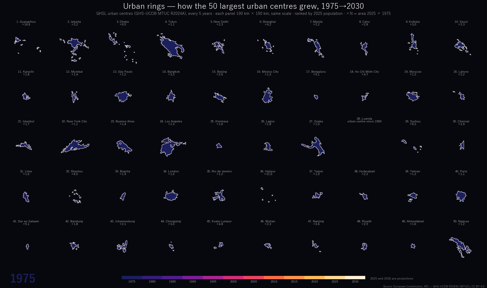

# Day 3 — Polygons

- DATE: 03-11-2026
- NAME: Polygons
- 投稿するもの: 下の「都市の年輪」（1枚の図）。前に作った用途地域の地図は未投稿（ページの下）

## Description（公式）

> A map challenge classic. Map with polygons.

## Description（日本語訳）

マップチャレンジの定番。ポリゴンで地図を作る。

## 投稿するもの: 都市の年輪（Urban rings）



最後の年の1枚: [urban_rings.png](urban_rings.png)

2025年の人口が多い順に50の都市中心について、1975年から2030年まで5年ごとの都市中心のポリゴンを、年輪のように重ねた。内側の暗い藍ほど古く、外側の白に近い色ほど新しい。アニメーションでは、その年の外周を光らせる。どの図も 190 km 四方で、同じ縮尺。

- 広州は1975→2025年に都市中心の面積が16.6倍、ダッカは9.5倍。東京は1.1倍、大阪は1.0倍で、ほとんど広がっていない
- 上位50のうち、15都市は1.5倍未満、13都市は3倍以上
- ルアンダは1975年には都市中心がなく、1990年に都市中心になった（図には倍率の代わりにそう書いた）

### 都市中心とは

GHSL の都市化度（Degree of Urbanisation）の定義で、人口密度が1 km²あたり1,500人以上の 1 km マスがつながり、合計5万人以上になるまとまり（GHSL Data Package 2023）。市区町村などの行政の境界ではない。名前（GC_UCN_MAI_2025）は、まとまりの中のおもな都市の名前で、データに入っているものをそのまま使った。

### 言える範囲

- 面積と倍率は、データの列（MT_UCA_KM2_1975・MT_UCA_KM2_2025）をそのまま使った。倍率は「都市中心と判定された範囲」の広がりで、建物が建った面積や人口の伸びではない
- 都市中心は人口密度で決まるので、郊外に低い密度で広がった部分（スプロール）は含まれない
- 2025・2030年は予測
- 隣の都市中心とつながると1つにまとまり、同じ ID のポリゴンとして過去にさかのぼる。ハジプール（31.0倍）・広州（16.6倍）のように倍率が極端に大きい都市は、1975年の都市中心が小さかったうえ、周りのまとまりがつながって大きくなった
- 順位は2025年の人口（MT_POP_TOT_2025）で、データの推計値

### 作り方

```sh
# GHS-UCDB R2024A MTUC（V1.2）を取得して展開
curl -L -o data/ucdb_mtuc/mtuc.zip https://jeodpp.jrc.ec.europa.eu/ftp/jrc-opendata/GHSL/GHS_UCDB_GLOBE_R2024A/GHS_UCDB_MTUC_GLOBE_R2024A/V1-2/GHS_UCDB_MTUC_GLOBE_R2024A_V1_2.zip
python -I -X utf8 scripts/urban_rings.py data/ucdb_mtuc/GHS_UCDB_MTUC_GLOBE_R2024A.gpkg output   # 図・GIF・MP4
cp output/urban_rings.png output/urban_rings.gif .
```

- 年ごとのレイヤー（GHSL_UCDB_MTUC_{年}_GLOBE_R2024）から、その都市中心と同じ ID（ID_UC_G0）のポリゴンだけを描く。新しい年から先に描き、古い年を上に重ねる
- 色は暗い藍→紫→赤→橙→白の12段。光は、太さと濃さを変えた外周の線を4本重ねて、ぼかしたように見せる。図形は一度だけ作り、年ごとには表示を切り替えて書き出す（GIF は1コマ0.7秒、最後の年で3秒止める）。matplotlib・GeoPandas・ffmpeg で作った。GHSL 全体の整理は [docs/ghsl.md](../docs/ghsl.md)

### データ

- European Commission, Joint Research Centre — GHS-UCDB R2024A（GHS Urban Centre Database 2025）MTUC V1.2（CC BY 4.0）を加工して作成。doi:10.2905/1a338be6-7eaf-480c-9664-3a8ade88cbcd

### 投稿文の下書き

本文:

```text
#30DayMapChallenge Day 3 - Polygons
世界の人口上位50の都市中心の1975年からの広がりを、5年ごとのポリゴンで年輪のように描いてみました🗺️

📝広州は16.6倍、ダッカは9.5倍、東京は1.1倍。2025・2030年は予測です。

詳しくはこちら↓
https://github.com/shiwaku/30daymapchallenge-2026/tree/main/day03-polygons

#GHSL #Python #matplotlib
```

リプライ:

```text
出典）European Commission, JRC — GHS-UCDB R2024A（MTUC）、CC BY 4.0 を加工して作成
制作に生成AI（Claude Code）を使用（コードの作成）
```

## 未投稿: 建ててよい量で立ち上げた日本（用途地域）

Day 3 用に作ったが、投稿は上の図にした。別の日に回せる。

- ビューワ: https://shiwaku.github.io/30daymapchallenge-2026/day03-polygons/site/

### 地図のテーマ

建ててよい量で立ち上げた日本（用途地域を容積率の高さに立ち上げる）

### 内容

用途地域には、土地の広さに対してどれだけの床を建ててよいか（容積率）が決まっている。全国の用途地域の面を、容積率に比例した高さに立ち上げ、用途地域の13色で塗る。斜めの視点で、東京・大阪・名古屋・福岡・札幌・関東を順に見て回る（ボタンでも移動できる）。

都心は商業地域が一面の台地になり、周りの住宅地は低く残る。幹線道路沿いだけを指定した用途地域は、細長い壁になって街に網の目を描く。

容積率が分かる面の71%は200%で、1000%以上は合わせて約4.2km²しかない。いちばん高い1300%は千代田区・名古屋市（と中央区のごく一部）だけ。数字はビューワが `data/stats.json` から計算して出す。

### 言える範囲

- 国土交通省「都市計画決定GISデータ」に入っている市区町村（1,215）だけの数字。自治体が GIS データを出していない場合などは入っていないので、日本全体の値ではない
- データは参考情報で、範囲は概ねの位置（提供元の注記）。時点は自治体ごとに違う
- 面積は、容積率の入っている面（101,695面のうち93,598面）で数えた割合。容積率が入っていない8,097面（134市区町村）は灰色で平らに描き、割合から外した
- 高さは容積率に比例させ、ズームを引くほど大きく誇張している（建物の高さではない）。同じ画面の中では比べられるが、ズームの違う画面どうしは比べられない
- 「国土の約5%」は、用途地域の合計面積を国土面積377,975km²で割った目安

### 使用する技術

- Python（DuckDB spatial）で列を絞り、面積と集計値を出す（`scripts/prepare.py`）
- **tylertoo** で GeoParquet → PMTiles（ズーム4〜14、容積率の高い面を上に描く）
- Vite 8 ＋ MapLibre GL JS 6（TypeScript）。`fill-extrusion` で面を立ち上げる。背景は地理院タイル（淡色地図）を暗くして色を抜いたもの
- 公開版は `site/`（`npm run build` の出力）。GitHub Pages では /day03-polygons/site/

### 作り方

```sh
# mlit-urban-planning-converter の Release data-20260707 の toshikeikaku-qgis.zip から youto.parquet を取り出す
# https://github.com/shiwaku/mlit-urban-planning-converter/releases/tag/data-20260707
python -I scripts/prepare.py <youto.parquet> data/work data/youto_far.pmtiles   # tylertoo と duckdb の入った環境で
cp data/work/stats.json data/stats.json
npm install
npm run dev     # http://localhost:5173/
npm run build   # site/ に出力
```

### データの加工

`scripts/prepare.py` でやること（値は変えない）:

- 提供元の誤り（[mlit-urban-planning-converter #25](https://github.com/shiwaku/mlit-urban-planning-converter/issues/25)）: 長野県箕輪町のファイルに入っている新潟市の用途地域の複製458面を外す（Citycode 20383 で中心が北緯37度より北）
- 「調整」（コード0、茅ヶ崎市の6面）は用途地域ではないので外す
- 不正なジオメトリは ST_MakeValid で直す
- 容積率（FAR）は数値にして使う。空のものは空のまま

### データ

- [国土交通省「都市計画決定GISデータ」](https://www.mlit.go.jp/toshi/tosiko/toshi_tosiko_tk_000087.html)（令和7年度）を加工して作成。利用条件は国土交通省ウェブサイトの利用ルール（公共データ利用規約 第1.0版）。変換には [mlit-urban-planning-converter](https://github.com/shiwaku/mlit-urban-planning-converter) の Release data-20260707 を使った
- 背景: [地理院タイル](https://maps.gsi.go.jp/development/ichiran.html)（淡色地図）

### 状況

- [x] データ準備
- [x] 地図作成（index.html）
- [ ] 投稿用の動画
- [ ] 投稿（#30DayMapChallenge）

### 経緯

最初の案は「全国の用途地域を13種類の色だけで描く」だったが、同じ地図は mlit-urban-planning-converter のビューワですでに作っているので、容積率で立ち上げる見せ方に替えた（2026年10月31日）。
