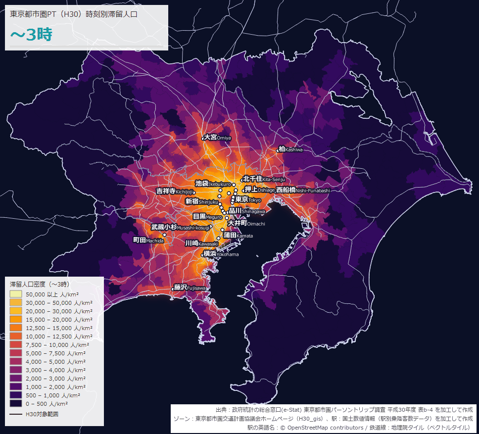
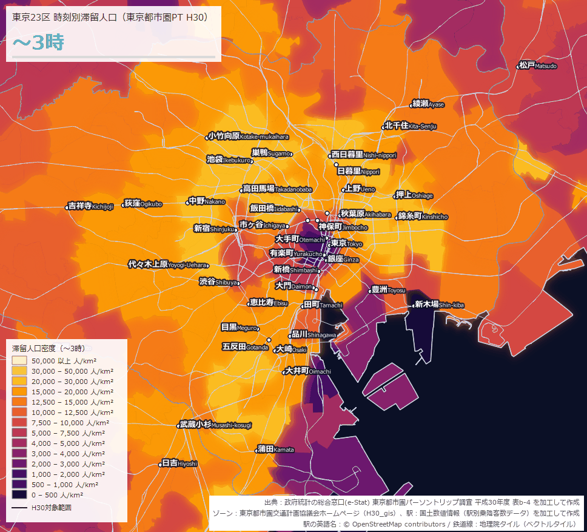

# Day 3 — Polygons

- DATE: 03-11-2026
- NAME: Polygons
- 投稿: 2026年11月3日（X）。夜景版（首都圏→23区の約40秒の動画）

## Description（公式）

> A map challenge classic. Map with polygons.

## Description（日本語訳）

マップチャレンジの定番。ポリゴンで地図を作る。

## 首都圏の滞留人口、1時間ごと





13時台の1枚: [首都圏](pt_stay_region_night_13h.png) / [23区](pt_stay_23ku_night_13h.png)。投稿用の動画は `output/day03-pt-stay_night.mp4`（首都圏→23区、約40秒。Git には入れていない）。主要駅は国土数値情報の駅別乗降客数（2018年）の上位で、日本語と英語の名前を並べた。

淡色の地図の上に塗った版（駅名なし）: [首都圏](pt_stay_region.gif) / [23区](pt_stay_23ku.gif)

平日の1日に、その時刻にそのゾーンにいた人の数（滞留人口）を、ゾーンの面積で割って1時間ごとに塗り分けた。ゾーンは東京都市圏パーソントリップ調査の計画基本ゾーン（615）。朝7〜9時に都心のゾーンが濃くなり、郊外が薄くなる。夜はその逆に戻る。

- 千代田区のゾーン（4つ）の合計は、いちばん少ない27時〜（翌朝3時以降）が約5.9万人、いちばん多い14時台が約98.5万人で、約17倍
- 都心3区（千代田・中央・港、14ゾーン）では約44.8万人→約249.9万人で、約5.6倍

### 言える範囲

- H30（2018年）の調査で、平日1日の動き。抽出率は約1%で、拡大して出した推計値。休日や今の数字ではない
- 計画基本ゾーン単位なので、ゾーンの中のどこに人がいたかは分からない。郊外のゾーンは広く、密度が薄めに出る
- 区の合計は、ゾーンを小ゾーンの市区町村コード（JisCode）で区に割り当てて足した
- 時刻は1時間ごとの26区分（〜3時、3時台〜26時台、27時〜）。b-4 の値をそのまま使い、時刻の間は補っていない

### 作り方

1. e-Stat から b-4 の CSV を、協議会のホームページから H30_gis.zip（小ゾーン・計画基本ゾーンの shp）を取得し、`data/raw/` に置く
2. `pt-stay/scripts/join_b4_kzone.py`: b-4 を計画基本ゾーンに結合し、`data/pt_h30_zones_b4.gpkg` を作る（小ゾーンを融合して都県界と調査範囲も作る）
3. `pt-stay/scripts/anim_kzone_b4_ptinfo.py`: QGIS の Python コンソールで実行し、首都圏と23区の26コマを書き出す。色は14段。夜景版は `pt-stay/scripts/glow_samples.py` で、暗い背景に塗りを光らせ、地理院タイル（ベクトルタイル）の鉄道線と主要駅を重ねる。主要駅（GPKG の stations_major）は、国土数値情報 S12 を駅グループごとにまとめ、OSM の name:en を付けて QGIS 上で作った（作ったスクリプトは残っていない）
4. `pt-stay/scripts/fix_credit_and_video.py`: 出典の行を描き直し、GIF と mp4（最初と最後のコマは1.4秒、ほかは0.7秒）にする

```sh
python pt-stay/scripts/fix_credit_and_video.py <首都圏のコマ> <23区のコマ> output night   # 夜景版
python pt-stay/scripts/fix_credit_and_video.py <首都圏のコマ> <23区のコマ> output         # 淡色版
```

### データ

- 政府統計の総合窓口(e-Stat)（https://www.e-stat.go.jp/）東京都市圏パーソントリップ調査 平成30年度「表b-4：ゾーン別・時刻別滞留人口」（[CSV](https://www.e-stat.go.jp/stat-search/file-download?statInfId=000032066122&fileKind=1)）を加工して作成。利用条件は政府統計の総合窓口(e-Stat)の利用規約
- 東京都市圏交通計画協議会ホームページ（https://www.tokyo-pt.jp/data/01_01）の H30_gis（小ゾーン・計画基本ゾーンの shp）を加工して作成。利用条件は公共データ利用規約（第1.0版）
- [国土数値情報 駅別乗降客数データ（S12）](https://nlftp.mlit.go.jp/ksj/gml/datalist/KsjTmplt-S12-2024.html)（CC BY 4.0）を加工して作成（夜景版の主要駅）
- 駅の英語名: © OpenStreetMap contributors（ODbL）
- 鉄道線・背景: [地理院タイル](https://maps.gsi.go.jp/development/ichiran.html)（ベクトルタイル・淡色地図、国土地理院）

### 投稿文

本文:

```text
#30DayMapChallenge Day 3 - Polygons
首都圏の平日1日の滞留人口を、パーソントリップ調査のゾーンごとに1時間ずつ塗ってみました🗺️

📝千代田区は深夜の約5.9万人が、14時台には約98.5万人に。約17倍です。2018年の調査です。

詳しくはこちら↓
https://github.com/shiwaku/30daymapchallenge-2026/tree/main/day03-polygons

#QGIS #パーソントリップ調査
```

リプライ:

```text
出典）政府統計の総合窓口(e-Stat) 東京都市圏パーソントリップ調査 平成30年度 表b-4、東京都市圏交通計画協議会ホームページ（H30_gis）、国土数値情報（駅別乗降客数データ）を加工して作成／駅の英語名 © OpenStreetMap contributors／鉄道線：地理院タイル
制作に生成AIを使用（コードの作成）
```
