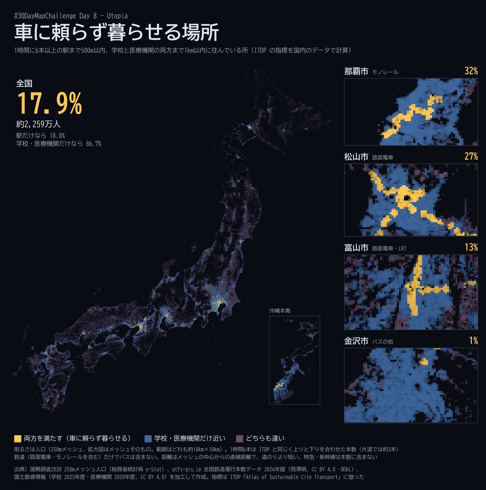
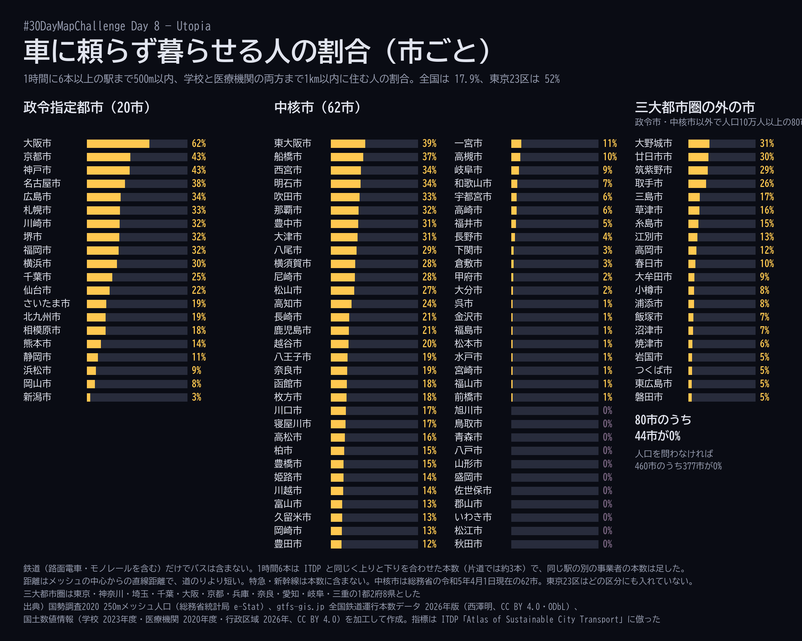

# Day 8 — Utopia

- DATE: 08-11-2026
- NAME: Utopia

## Description（公式）

> A map of something which could be.

## Description（日本語訳）

ありえるかもしれない何かの地図。

## 地図のテーマ

車に頼らず暮らせる場所（全国の250mメッシュ）

## 内容

公共交通と徒歩で暮らせて、車に頼らなくてよい街を「ありえるかもしれない」理想の街として、その条件を満たす場所がいまの日本にどれだけあるかを全国の250mメッシュで描く。まず国内で作り、次に同じ定義で海外の都市と比べる予定。

条件は ITDP（Institute for Transportation and Development Policy）の [Atlas of Sustainable City Transport](https://itdp.org/publication/the-atlas-of-sustainable-city-transport) の指標のうち2つに倣った（計算コード [ITDP/pedestriansfirst](https://github.com/ITDP/pedestriansfirst) で定義を確かめた）。

| 指標（ITDP の名前） | 条件 | 国内で使ったデータ |
|---|---|---|
| 公共交通が近い（People Near Frequent Transit） | 1時間に6本以上来る駅まで500m以内 | gtfs-gis.jp 全国鉄道運行本数データ 2026年版（事業者別・駅別） |
| 生活施設が近い（People Near Services） | 学校と医療機関の両方が1,000m以内 | 国土数値情報 学校（P29、2023年度）・医療機関（P04、2020年度） |

両方を満たすメッシュに住む人を「車に頼らず暮らせる」とし、その人数の割合を全国・都道府県・市区町村で出す。ITDP の残りの指標（車の入らない場所、街区の細かさ、自転車道など）は、「車なしで暮らせるか」との関係が間接的なのと、OSM の描き込みの差が出やすいので使わない。





### 主な数字

- 全国: **17.9%**（約2,259万人）。駅の条件だけなら18.0%、学校・医療機関の条件だけなら86.7%で、差を生むのはほぼ駅
- 都道府県: 東京43%、大阪38%、京都32%、兵庫26%、神奈川26%。岩手・山形・青森・島根・鳥取・秋田は0%
- 政令指定都市（20市）: 大阪市62%がいちばん高く、京都市43%、神戸市43%、名古屋市38%。低いのは新潟市3%、岡山市8%、浜松市9%
- 中核市（62市）: 東大阪市39%、船橋市37%、西宮市34%。地方では那覇市32%（モノレール）、松山市27%・高知市24%（路面電車）が高い。11市が0%（いわき・佐世保・八戸・山形・旭川・松江・盛岡・秋田・郡山・青森・鳥取）
- 隣どうしの県庁所在地で、富山市13%（路面電車・LRT）に対し金沢市1%（駅は金沢駅でも1日105本で、基準の108本にわずかに届かない）
- 三大都市圏の外で、政令指定都市・中核市以外の人口10万人以上の市（80市）: 上位は大野城市31%、廿日市市30%、筑紫野市29%。44市が0%
- 東京23区は52%（区ごとでは千代田区97%、新宿区84%、品川区82%、荒川区80%）

数字は `carfree/city_carfree.csv`（市区町村。政令指定都市は市でまとめ、東京23区は区ごと）と `carfree/pref_carfree.csv`（都道府県）。`transit` は駅の条件、`service` は学校・医療機関の条件、`both` は両方を満たす人の割合。

### 計算の方法

- 人口: 国勢調査2020の250mメッシュ（5次メッシュ）の総人口。人口0のメッシュは除く。全国で1,163,745メッシュ・126,145,734人（公表値 126,146,099人との差の365人は、ダウンロードした1次メッシュに入らなかった小さな島の分）
- 距離: メッシュの中心から点までの直線距離（大圏距離）。ITDP は道のりで測るので、こちらの方が広めに出る
- 1時間6本: ITDP は「平日の7〜21時に、停留所での平均の間隔が10分以下（上りと下りを合わせる）」。gtfs-gis.jp の駅別データは平日1日の本数なので、上りと下りの発車本数の合計が108本以上（6本×18時間。Day 2 と同じく6〜24時でならした）の駅とした。片道ではおよそ1時間3本
- 同じ駅の別の事業者（長野駅の JR・しなの鉄道・長野電鉄など）は、同じ駅名で300m以内のものを1つの駅として本数を足した（乗り換えて使えるため）。これで基準を満たす駅は 3,916 → 4,083 駅（全9,416駅のうち）
- 学校: ITDP は OSM の `amenity=school|kindergarten`。国内は幼稚園・小学校・中学校・義務教育学校・中等教育学校・高等学校・特別支援学校・幼保連携型認定こども園（休校中を除く、51,186校）。大学・短大・高専・専修学校・各種学校は含めない
- 医療機関: ITDP は病院・診療所・薬局（歯科は含めない）。国内は病院と一般診療所（112,452施設）。薬局は国土数値情報にないので含めない
- 市区町村: メッシュの中心が入る市区町村（国土数値情報 行政区域 2026年1月1日時点）。海岸沿いで中心が陸地から外れる8,253メッシュ（204,790人）は、いちばん近い市区町村に入れた
- 中核市は総務省の「中核市・施行時特例市」のページの令和5年4月1日現在の62市。三大都市圏は東京・神奈川・埼玉・千葉・大阪・京都・兵庫・奈良・愛知・岐阜・三重の1都2府8県とした

### 言える範囲

- **鉄道だけで、バスを含めない**。バスが中心の街（金沢・新潟・長野など）は低く出る。全国のバスの時刻表（GTFS-JP）は事業者ごとに抜けがあるので、今回は入れていない
- 1時間6本は上りと下りを合わせた数で、片道では約3本。ITDP に合わせた基準で、日本の都市の感覚よりは緩い。特急・新幹線と、追加料金の要る列車は本数に含まない（gtfs-gis.jp のデータの決め方）
- 本数は2026年3〜4月に数えた平日のもので、時間帯ごとの本数はない。朝夕に集中して走る線も1日でならしている
- 距離は直線なので、川・線路・高速道路を渡る遠回りは考えていない。道のりで測れば割合は下がる
- 「学校と医療機関が近い」は施設があることだけで、小児科か、定員に空きがあるかなどは見ていない。医療機関は2020年度、学校は2023年度の時点
- 人口は2020年の国勢調査で、駅（2026年）と時点が違う。宇都宮ライトレール（2023年開業）のように、その後にできた線の沿線の人口は2020年のもの
- 「車に頼らず暮らせる」は上の2つの条件を満たすという意味で、実際に車を持たずに暮らしている人の割合ではない

## データ

- 国勢調査2020 250mメッシュ人口（総務省統計局、[e-Stat](https://www.e-stat.go.jp/gis/statmap-search?type=1) 統計表 T001142）を加工して作成
- [gtfs-gis.jp 全国鉄道運行本数データ](https://gtfs-gis.jp/railway_honsu/) 2026年版・事業者別・駅別発着本数（作成: 西澤明、ライセンス: CC BY 4.0 / ODbL）を加工して作成
- 国土数値情報 学校データ（P29、2023年度）・医療機関データ（P04、2020年度）・行政区域データ（N03、2026年1月1日時点）（国土交通省、CC BY 4.0）を加工して作成
- 指標の定義: ITDP「The Atlas of Sustainable City Transport」、計算コード [ITDP/pedestriansfirst](https://github.com/ITDP/pedestriansfirst)（MIT）。ITDP のデータ（数値）は使っていない

## 使用する技術

- Python（GeoPandas・pyogrio・SciPy の cKDTree で最も近い駅・施設までの距離を出す。緯度経度を3次元の単位ベクトルにし、弦の長さから大圏距離に直す）
- 画像は Pillow で描く（全国図は1画素に入るメッシュの人口を色ごとに足して混ぜる。拡大図はメッシュをそのまま四角で塗る）。フォントは BIZ UDゴシック

## 作り方

```sh
mkdir -p data/ksj data/rail data/n03
curl -o data/rail/unkohonsu2026_eki.geojson https://gtfs-gis.jp/railway_honsu/data/unkohonsu2026_eki.geojson
curl -L -o data/ksj/P29-23_GML.zip https://nlftp.mlit.go.jp/ksj/gml/data/P29/P29-23/P29-23_GML.zip && unzip -o data/ksj/P29-23_GML.zip -d data/ksj/p29
curl -L -o data/ksj/P04-20_GML.zip https://nlftp.mlit.go.jp/ksj/gml/data/P04/P04-20/P04-20_GML.zip && unzip -o data/ksj/P04-20_GML.zip -d data/ksj/p04
curl -L -o data/n03/N03-20260101_GML.zip https://nlftp.mlit.go.jp/ksj/gml/data/N03/N03-2026/N03-20260101_GML.zip && unzip -o data/n03/N03-20260101_GML.zip "N03-20260101.*" -d data/n03
python -I -X utf8 scripts/carfree/fetch_mesh.py data            # e-Stat から149の1次メッシュ分（約2分）
python -I -X utf8 scripts/carfree/analyze.py data data/carfree  # 約2分
python -I -X utf8 scripts/carfree/poster.py data/carfree output/carfree/poster.png
python -I -X utf8 scripts/carfree/ranking.py data/carfree output/carfree/ranking.png
```

## 投稿文の下書き

本文:

```text
#30DayMapChallenge Day 8 - Utopia
車に頼らず暮らせる場所を、全国の250mメッシュで塗ってみました🗺️
📝1時間6本以上の駅まで500m、学校と病院・診療所まで1kmの両方を満たすのは全国で17.9%。中核市62市のうち11市は0%、富山13%に対し金沢1%（ITDPの指標、鉄道のみ）
#OpenData #Python
```

リプライ:

```text
出典）国勢調査2020 250mメッシュ人口（e-Stat）、gtfs-gis.jp 全国鉄道運行本数データ2026年版（西澤明、CC BY 4.0/ODbL）、国土数値情報（学校・医療機関・行政区域）を加工して作成
制作に生成AI（Claude Code）を使用（データの集計とコードの作成）
```

X の文字数で270（日本語2で数えた）。画像は `carfree/day08-carfree-map.png`（全国と地方の4市）と `carfree/day08-carfree-cities.png`（市ごとの順位）の2枚。どちらも画面内に出典あり。

## 状況

- [x] データ準備
- [x] 集計（全国・都道府県・市区町村）
- [x] 投稿用の画像（2枚）
- [ ] 投稿（#30DayMapChallenge）
- [ ] 海外の都市との比較（同じ定義で。人口は GHSL、時刻表は Mobility Database の GTFS を想定）

## 別案: 自転車の道が、つながったら（未投稿）

最初に Day 8 として作った地図。お題の「理想」には弱いので投稿は上の地図に替え、別の日に回す候補として残す。ビューワ: https://shiwaku.github.io/30daymapchallenge-2026/day08-utopia/site/

### 内容

OpenStreetMap（OSM）で「自転車に適した道」として描かれている道を、1都3県（東京都〈島しょ部を除く〉・神奈川県・埼玉県・千葉県）で集め、ひと続きに走れるつながり（連結成分）ごとに、その長さで色を変えて描く。長いつながりほど明るく、いちばん長いつながりは黄色に光らせる。背景は幹線道路・川・都県境だけを薄く置く。陸地の形と都県境は国土数値情報の行政区域を使う（OSM の都県の境界は海の上まで入っているため）。

そのうえで、短いすき間を埋めたらどこまでつながるかを計算して見せる（お題の「ありえるかもしれない」）。最初は自動で進み、ボタンで行き来できる。

1. いまの自転車の道: 約2,408kmの道が2,209のかたまりに分かれていて、いちばん長いつながりは93.1km（全体の3.9%、江戸川沿い）。2番目は60.5km（荒川の下流沿い）
2. 300m以下のすき間を埋めると: 92か所・合計11.1kmで、いちばん長いつながりは132.8km（江戸川沿いから広がる）
3. 1km以下のすき間を埋めると: 179か所・合計62.8kmで、いちばん長いつながりは305.1km（全体の12.7%、多摩川沿いを軸に、立川・府中・小金井あたりから川崎まで）。このつながりに入るすき間は35か所・合計14.1km

すき間はピンクの線で示す。線にマウスを乗せると、すき間の長さと、つなぐ2つのつながりの長さを出す。

#### 自転車に適した道の決め方（OSM のタグ）

次のどれかに当てはまる道（way）。

| 種類 | タグ |
|---|---|
| 自転車道 | `highway=cycleway`（`bicycle_road=yes`・`cyclestreet=yes` も含む） |
| 車道の自転車レーン・自転車道 | `cycleway` / `cycleway:both` / `cycleway:left` / `cycleway:right` が `lane` / `track`（`opposite_lane` / `opposite_track` を含む） |
| 歩行者と共用 | `highway=path` / `footway` / `pedestrian` / `track` / `bridleway` で `bicycle=designated`。ただし車道沿いの歩道（`footway=sidewalk`）は除く |

次のものは含めない。

- `bicycle=no` / `dismount` / `private` / `use_sidepath` の道、`access=private` / `no` の道（自転車が許されている場合を除く）、工事中・計画中の道、階段、広場（`area=yes`）
- 矢羽根（`cycleway=shared_lane`。約876km）。車と同じ車線を走るため
- 車道沿いの歩道で `bicycle=designated` のもの（自転車通行可の歩道。約218km）。歩道を走ることになるため
- 自転車が通ってよいだけの道（`bicycle=yes`）と、住宅地の静かな道。含めると、ほぼすべての道がつながってしまい、「自転車のための道」の地図でなくなるため

#### つながりとすき間の計算

- 道どうしが OSM のノードを共有していれば、つながっているとみなす。加えて、道の端点から20m以内に別の道があれば、つながっているとみなす（道路の横断や、データの小さな切れ目）
- つながりの長さは、つながっている道の中心線の長さの合計（車道の両側にレーンがあっても1本として数える）。距離は JGD2011 平面直角座標系 第IX系（EPSG:6677）で測る
- すき間は、長さ2km以上のつながり（275個）どうしで、いちばん近い2点を直線で結んだ線。1km以下の組は239組あった
- すき間を短い順に埋めていき、すでに同じつながりになった組は飛ばす（クラスカル法の最小全域森）。「300mまで」「1kmまで」は、この順で 300m・1km 以下のすき間だけを埋めた状態
- 線が交わっているのにノードを共有していない組は、すき間に数えない（2組。荒川の河川敷の道と、その上を通る鹿浜橋の歩道のような立体交差）

#### 言える範囲

- OSM に描かれている道の地図で、実際の自転車の道のすべてではない。OSM の描き込みは地域・人によって差があり、描かれていない自転車レーンや、タグの付け方が違う道もある。描き込みの多い地域ほど長く、多く見える
- 「自転車に適した」は上のタグの決め方によるもので、走りやすさや安全を確かめたものではない。歩行者と共用の道や川沿いの道には、歩行者が多い所、段差や車止めのある所もある
- すき間は直線距離で、計算の結果。整備の計画ではなく、その間に実際に通れる道があるか、川や線路を越えられるかも確かめていない。直線より実際の道のりは長い
- 2km未満のつながり（1,934個、合計約703km）は、すき間の計算に入れていない
- データは 2026年11月1日時点の OSM（Geofabrik の抽出）

### データ

- © OpenStreetMap contributors（ODbL）。[Geofabrik](https://download.geofabrik.de/asia/japan/kanto.html) の関東の抽出 `kanto-261101.osm.pbf`（2026-11-01 時点）を加工して作成
- 国土数値情報 行政区域データ（N03、2026年1月1日時点。国土交通省、CC BY 4.0）を加工して作成。陸地の形・都県境・面積に使う。https://nlftp.mlit.go.jp/ksj/gml/datalist/KsjTmplt-N03-2026.html
- ビューワが読むデータは `web/`（OSM から作った派生データなので ODbL。`land.geojson` と `base.geojson` の都県境は国土数値情報から作ったもの）

### 使用する技術

- DuckDB spatial（`ST_ReadOSM` で .osm.pbf を読み、道の線を組み立てる）
- Python（GeoPandas・Shapely。つながりは Union-Find、すき間は STRtree と `shortest_line`）
- Vite 8 ＋ MapLibre GL JS 6（TypeScript）。データは GeoJSON（合計約5.9MB）をそのまま読む
- 道の線はつながりごとにまとめ、2m で簡略化している
- 公開版は `site/`（`npm run build` の出力）。GitHub Pages では /day08-utopia/site/。`web/` を `../web/` で読む
- スクリーンショットは playwright-core（Chrome）。`?step=0|1|2` で段階を指定、`?poster` で投稿用の画像（ボタンなし）

### 作り方

```sh
curl -L -o data/geofabrik/kanto-261101.osm.pbf https://download.geofabrik.de/asia/japan/kanto-261101.osm.pbf
# 国土数値情報 行政区域（埼玉 11・千葉 12・東京 13・神奈川 14）を data/n03/<コード>/ に展開
for p in 11 12 13 14; do curl -LO https://nlftp.mlit.go.jp/ksj/gml/data/N03/N03-2026/N03-20260101_${p}_GML.zip && unzip -o N03-20260101_${p}_GML.zip -d data/n03/$p; done
python -I -X utf8 scripts/extract.py data/geofabrik/kanto-261101.osm.pbf data/work   # 約1分
python -I -X utf8 scripts/analyze.py data/work web                                    # web/ に出力（約2分）
npm install
npm run dev     # http://localhost:5173/
npm run build   # site/ に出力
node scripts/shot.mjs http://localhost:5173/   # output/ にスクリーンショット
```

`scripts/fetch.py`（Overpass API で取る版）も置いてあるが、2026年11月2日には Overpass が混んでいてタイムアウトしたため、Geofabrik の抽出を使った。
